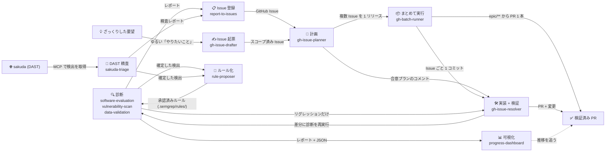

# maruda

**AI with a harness.** — AI 開発に、ハーネスをまるっと。
コード品質の評価、セキュリティ監査、コードから生成する仕様書、GitHub Issue 起点の
実装を行う Claude Code スキル群と、それを**環境側で**強制するフック・ルール・CI
ゲートの一式です。

English: [README.md](README.md)

## クイックスタート

Claude Code で 2 コマンド：

```
/plugin marketplace add northraystudio/maruda
/plugin install maruda@northraystudio
```

**作る。** やりたいことを書けば、Issue、計画、PR と続きます：

```
/maruda:gh-issue-drafter ログインAPIにレート制限を入れたい
/maruda:gh-issue-planner #42      # コードを調査し、合意プランを Issue にコメント
/maruda:gh-issue-resolver #42     # ブランチ → 実装 → テスト → PR → 検証
```

**調べる。** 品質とセキュリティのレポートが `docs/` に出て、ダッシュボードで
数値の推移を追えます：

```
/maruda:software-evaluation src/
/maruda:vulnerability-scan src/
/maruda:progress-dashboard
```

**Tips.** 自然文でも動きます。複数の Issue を回すなら `/goal` と組み合わせます：

| こう言う | 何が動くか |
| --- | --- |
| 「Issue #1 を実装して」 | その Issue に `gh-issue-resolver` |
| 「Issue #1 から #5 を計画して」 | `gh-issue-planner` が 1 回の調査で Issue ごとにプランを投稿 |
| 「Issue #1 から #5 をまとめて対応して」 | `gh-batch-runner`：`epic/**` ブランチ 1 本、Issue ごと 1 コミット、PR 1 本 |
| `/goal Issue #1 から #5 を対応して` | Claude Code の `/goal` は条件が満たされるまで作業を続ける。Issue ごとに計画 → 実装 → PR を、間で促さずに回す。止めるには `/goal clear` |

これをプロジェクトの既定の進め方にするなら（`CLAUDE.md`、フック、ルール、CI
ゲート）`/maruda:setup` を実行します。いくつか質問され、承認するまで何も書きません。

Claude Code 以外のエージェントでは、名前空間なしで同じスキルが入ります：

```bash
npx skills add northraystudio/maruda --skill '*' --agent claude-code -y --copy
```

## 目次

- [何が手に入るか](#何が手に入るか)
- [サイクル](#サイクル)
- [導入](#導入)
  - [使い方別の早見表](#使い方別の早見表)
  - [ハーネス一式](#ハーネス一式)
  - [スキルだけ](#スキルだけ)
  - [更新](#更新)
- [使い方](#使い方)
- [サンプル](#サンプル)
- [補足](#補足)
- [ライセンス](#ライセンス)

## 何が手に入るか

スキルは 13 個。診断系は**読み取り専用**で、証拠を出すだけでコードやデータを
書き換えません。

| スキル | 何をするか |
| --- | --- |
| [software-evaluation](skills/software-evaluation/SKILL.md) | 5 つの柱（アーキテクチャ / 信頼性 / 可観測性 / セキュリティ / DX）でコード品質を採点し、1〜10 のスコアカードとロードマップを出す |
| [vulnerability-scan](skills/vulnerability-scan/SKILL.md) | Semgrep を使った OWASP ベースのセキュリティ監査。深刻度と修正方針付き |
| [data-validation](skills/data-validation/SKILL.md) | 自前のフィクスチャか明示的に設定した非本番接続を読み、件数・NULL 率・分布・一意性・参照整合性・書式を検証する |
| [spec-doc](skills/spec-doc/SKILL.md) | コードから「生きた仕様書」を生成・同期し、ドキュメントと実装の乖離をなくす |
| [progress-dashboard](skills/progress-dashboard/SKILL.md) | 品質スコアとセキュリティ指摘の推移を見る HTML ダッシュボード |
| [report-to-issues](skills/report-to-issues/SKILL.md) | 評価・監査レポートを対話的に GitHub Issue に登録する |
| [sakuda-triage](skills/sakuda-triage/SKILL.md) | [sakuda](https://github.com/northraystudio/sakuda)（DAST）の検出を MCP 経由で取得し、ソースと突き合わせて confirmed / false-positive / accepted を `file:line` 付きで判定する。sakuda への書き戻しは承認後だけ |
| [rule-proposer](skills/rule-proposer/SKILL.md) | 確定した検出を、fixture でテスト済みの Semgrep ルールにする。ルールにできないものは理由を示す。書き込みは承認後だけ |
| [gh-issue-drafter](skills/gh-issue-drafter/SKILL.md) | ざっくりした要望を、完了条件・触らない範囲・設計方針の揃った Issue にする。大きすぎれば分割か Epic を提案 |
| [gh-issue-planner](skills/gh-issue-planner/SKILL.md) | Issue を調査し、合意プランをコメントとして投稿する |
| [gh-issue-resolver](skills/gh-issue-resolver/SKILL.md) | 合意プランをブランチで実装して PR を出し、診断を再実行して自分が壊した分だけ直す |
| [gh-batch-runner](skills/gh-batch-runner/SKILL.md) | 複数の Issue を 1 リリースにまとめる。Epic、`epic/**` に Issue ごと 1 コミット、PR は 1 本 |
| [setup](skills/setup/SKILL.md) | 短いインタビューでハーネスを導入する。言語は必ず質問し、自動検出しない |

## サイクル

スキルは、境界のある改善ループを成します：診断 → Issue → 計画 → 実装 ⇄ 検証。



支えているのは 3 つのルールです：

- **診断は読み取り専用。** 出力はレポートと Issue だけ。
- **実装には合意プランが要る。** `gh-issue-planner` が Issue に投稿したコメントが
  それで、resolver はその範囲を越えない。
- **自律性は帰属で縛る。** `gh-issue-resolver` は自分の差分に診断を再実行し、
  **自分が壊したもの**だけを 3 回まで直す。元から壊れていたものは
  `report-to-issues` に渡し、同じ PR では直さない。

各ステップの詳細、バッチの流れ、各スキルが何を出すか：
[docs/cycle.md](docs/cycle.md)（英語）。

## 導入

### 使い方別の早見表

| 状況 | やること |
| --- | --- |
| **Claude Code、スキルだけ欲しい** | [クイックスタート](#クイックスタート)の `/plugin` 2 コマンド |
| **別のエージェント、または plugin を使わない** | [クイックスタート](#クイックスタート)の `npx skills add` |
| **新規プロジェクト、言語が決まっている** | 下のフルのワンライナーに `--langs` と `--with-skills`。初回 push 後に `--protect` |
| **新規プロジェクト、言語が未定** | 下の最小のワンライナー（レールだけ）→ あとで `/maruda:setup` |
| **既存プロジェクト** | フルのワンライナー。既存の `CLAUDE.md` / settings / フックは上書きされず、settings のフックはマージされる。その後 `/maruda:setup` |
| **チームで共有したい** | `--copy`（ここでは既定）で入れて `.claude/`、`CLAUDE.md`、`.github/` をコミット。クローンした人は導入不要 |
| **フラグより質問に答えたい** | スキルを入れてから `/maruda:setup` |
| **ゲートを実際に効かせたい** | `--protect` を付けて再実行（push 済みの既定ブランチと `gh` の admin 権限が必要） |
| **AI の PR レビューを足したい** | `--pr-agent`（CI が既にあるなら `--no-ci --pr-agent`）と `OPENAI_KEY` シークレット。助言のみ |
| **更新したい** | [更新](#更新)を参照 |

```bash
# フル（言語は必ず明示。自動検出しない）
curl -fsSL https://raw.githubusercontent.com/northraystudio/maruda/main/harness/scripts/install.sh \
  | bash -s -- --langs go,typescript --pm pnpm --with-skills

# 最小（レールだけ）
curl -fsSL https://raw.githubusercontent.com/northraystudio/maruda/main/harness/scripts/install.sh \
  | bash -s -- --minimal
```

### ハーネス一式

スキルだけでは作業手順にとどまります。ハーネスは機械的な部分を足します：簡潔な
`CLAUDE.md`、4 つのフック（書き込み時フォーマット、危険コマンドのガード、
セッション開始時のコンテキスト、Stop 時の促し）、採点基準に揃えたコーディング
ルール、そして `--langs` を付けると厳格な GitHub Actions CI とセキュリティスキャン
（gitleaks と Semgrep は初日からゲート、Trivy は段階導入）。ツールの版は固定され、
フォーマットフックはコードをダウンロードしません。

既存ファイルは上書きされません。差分のあるファイルは `<file>.new` として提案され、
マージはあなたが行います。対応言語は Go / Python / TypeScript / JavaScript。

生成されるファイルの一覧、すべてのフラグ、ゲートの成熟度ラダー、他の入口
（クローンからの `setup.sh`、`--plugin`）：
[docs/install.ja.md](docs/install.ja.md)。

### スキルだけ

| 入れ方 | コマンド |
| --- | --- |
| Claude Code plugin（推奨） | `/plugin marketplace add northraystudio/maruda` → `/plugin install maruda@northraystudio`。スキルは `/maruda:<skill>` の形で入る |
| 任意のエージェント、CLI | `npx skills add northraystudio/maruda --skill '*' --agent claude-code -y --copy`（1 つなら `--skill spec-doc`） |
| 手動コピー | `cp -r skills/* .claude/skills/` |
| Git submodule | `git submodule add https://github.com/northraystudio/maruda.git .claude/maruda` |

plugin をリリースに固定する方法、`npx` の対話ピッカーで「何も選択されていない」
罠：[docs/install.ja.md#スキルだけ](docs/install.ja.md#スキルだけ)。

### 更新

```bash
claude plugin marketplace update northraystudio   # 先に marketplace
claude plugin update maruda@northraystudio        # 次に plugin
```

開いているセッションでは、そのあと `/reload-plugins` を実行します。`setup.sh` が
プロジェクトに書いたハーネスのファイルは plugin に含まれないので、導入コマンドを
再実行して、提案された `<file>.new` を確認してください。タグ固定時の扱いや
「already at the latest version」と出る場合：
[docs/install.ja.md#更新](docs/install.ja.md#更新)。

## 使い方

作業内容を伝えれば該当するスキルが適用されます。直接呼ぶこともできます：

```
/maruda:software-evaluation src/backend/
/maruda:vulnerability-scan src/
/maruda:data-validation db/
/maruda:spec-doc src/
/maruda:progress-dashboard
/maruda:report-to-issues docs/evaluation/myapp.20260406.md
/maruda:sakuda-triage
/maruda:rule-proposer docs/security-audit/myapp.20260406.md
/maruda:gh-issue-drafter
/maruda:gh-issue-planner #42
/maruda:gh-issue-resolver #42
/maruda:gh-batch-runner
/maruda:setup
```

自然文のトリガーは日英どちらでも効きます（「src/ を脆弱性スキャンして」、
「Issue #42を実装して」、「セットアップして」）。`npx skills add` で入れた場合は
名前空間なしで `/spec-doc`、`/setup` のようになります。

## サンプル


`examples/progress-dashboard/` に、3 か月分の評価・監査 JSON と、それから生成した
`dashboard.html` があります。ブラウザで開けます。

## 補足

- **決定の記録**は [`docs/adr/`](docs/adr/) に ADR として残しています。スキル名から
  接頭辞を外した理由、フックを plugin に移さない理由、リポジトリのルートを plugin
  兼 marketplace にした理由、リリースの切り方など。
- **スキル**は、特定の作業に必要な知識・手順・出力テンプレートをエージェントに
  与える Markdown ファイルです。導入すると、Claude Code が関連する依頼を認識して
  自動的に適用します。
- **名前**は「まるっと」と **DA**（Dev with AI）から。スキル、ルール、CI、
  セキュリティゲートが一式で届きます。
- **`dev-skills` から改名**（`ymd38/dev-skills` → `northraystudio/maruda`、
  2026-09-20）。旧 URL は転送されます。`yds-` 付きの名前で導入したプロジェクトは
  [移行ノート](docs/install.ja.md#yds--付きの名前からの移行)を参照してください。

## ライセンス

MIT — [LICENSE](LICENSE) を参照してください。
