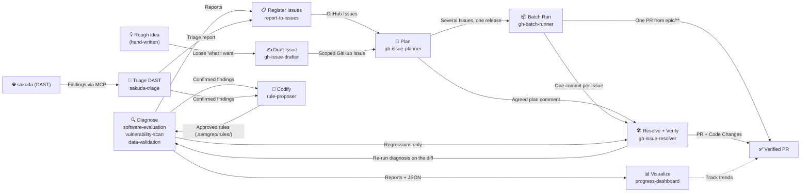
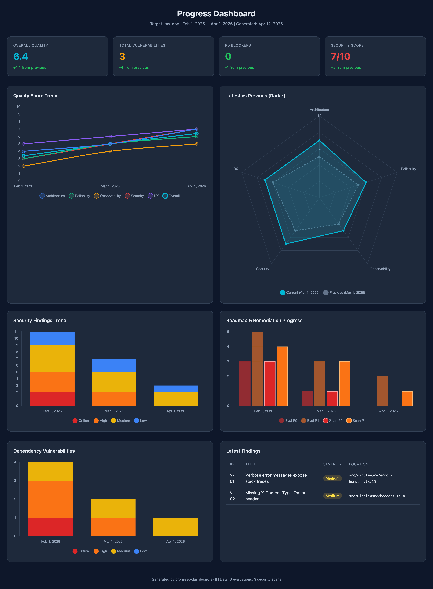

# maruda

**AI with a harness.** Claude Code skills for code quality, security audits,
living docs and GitHub-Issue-driven implementation — plus the hooks, rules and
CI gates that make the *environment* enforce quality, not the prompt.

日本語版は [README.ja.md](README.ja.md) にあります。

## Quick start

In Claude Code, two commands:

```
/plugin marketplace add northraystudio/maruda
/plugin install maruda@northraystudio
```

**Build something.** Describe what you want; the Issue, the plan and the PR follow:

```
/maruda:gh-issue-drafter add rate limiting to the login endpoint
/maruda:gh-issue-planner #42      # investigates, posts the agreed plan on the Issue
/maruda:gh-issue-resolver #42     # branch → implement → tests → PR → verify
```

**Check the code.** Quality and security reports land in `docs/`, and the
dashboard shows how the numbers move over time:

```
/maruda:software-evaluation src/
/maruda:vulnerability-scan src/
/maruda:progress-dashboard
```

**Tips.** Plain language works too, in English or Japanese — and `/goal` keeps the cycle running across several Issues:

| Say | What runs |
| --- | --- |
| "Implement Issue #1" / 「Issue #1 を実装して」 | `gh-issue-resolver` on that Issue |
| "Plan Issues #1 to #5" / 「Issue #1 から #5 を計画して」 | `gh-issue-planner` investigates once and posts one plan per Issue |
| "Ship Issues #1 to #5 together" / 「Issue #1 から #5 をまとめて対応して」 | `gh-batch-runner`: one `epic/**` branch, one commit per Issue, one PR |
| `/goal Handle Issues #1 to #5` | Claude Code's `/goal` keeps working until the condition is met — plan → resolve → PR for each Issue, with no prompting in between. `/goal clear` to stop |

To make this the default way of working in the project — `CLAUDE.md`, hooks,
rules, CI gates — run `/maruda:setup`. It asks a few questions and writes
nothing until you approve.

Not on Claude Code? The same skills install without a namespace:

```bash
npx skills add northraystudio/maruda --skill '*' --agent claude-code -y --copy
```

## Table of contents

- [What you get](#what-you-get)
- [The cycle](#the-cycle)
- [Install](#install)
  - [By use case](#by-use-case)
  - [Full harness](#full-harness)
  - [Skills only](#skills-only)
  - [Update](#update)
- [Usage](#usage)
- [Examples](#examples)
- [More](#more)
- [License](#license)

## What you get

Thirteen skills. The diagnostic ones are read-only — they produce evidence and
never edit code or data.

| Skill | What it does |
| --- | --- |
| [software-evaluation](skills/software-evaluation/SKILL.md) | Scores code quality on five pillars (Architecture, Reliability, Observability, Security, DX) with a 1–10 scorecard and a roadmap |
| [vulnerability-scan](skills/vulnerability-scan/SKILL.md) | OWASP-based security audit with Semgrep; severity-rated findings with remediation |
| [data-validation](skills/data-validation/SKILL.md) | Checks counts, NULL rates, distribution, uniqueness, referential integrity and formats on your own fixtures or a configured non-production source |
| [spec-doc](skills/spec-doc/SKILL.md) | Generates or syncs a living specification from source so docs stop drifting |
| [progress-dashboard](skills/progress-dashboard/SKILL.md) | HTML dashboard of quality scores and security findings over time |
| [report-to-issues](skills/report-to-issues/SKILL.md) | Turns evaluation and audit reports into GitHub Issues, interactively |
| [sakuda-triage](skills/sakuda-triage/SKILL.md) | Checks [sakuda](https://github.com/northraystudio/sakuda) (DAST) findings against the source via its MCP: confirmed / false-positive / accepted with `file:line`, written back to sakuda after approval |
| [rule-proposer](skills/rule-proposer/SKILL.md) | Turns confirmed findings into Semgrep rules with tested fixtures — or says why a finding cannot be a rule; writes only after approval |
| [gh-issue-drafter](skills/gh-issue-drafter/SKILL.md) | Turns a rough idea into a scoped Issue (Done / Out of scope / Design constraints); splits or files an Epic when it is too big |
| [gh-issue-planner](skills/gh-issue-planner/SKILL.md) | Investigates an Issue and posts an agreed plan as a comment |
| [gh-issue-resolver](skills/gh-issue-resolver/SKILL.md) | Implements the agreed plan on a branch, opens a PR, re-runs the diagnosis and fixes only the regressions it caused |
| [gh-batch-runner](skills/gh-batch-runner/SKILL.md) | Ships several planned Issues as one release: an Epic, one commit per Issue on `epic/**`, one PR |
| [setup](skills/setup/SKILL.md) | Installs the harness through a short interview — languages are asked, never auto-detected |

## The cycle

The skills form a bounded improvement loop: diagnose → file an Issue → plan →
resolve ⇄ verify.



Three rules hold it together:

- **Diagnosis is read-only.** Reports and Issues are the only output.
- **Implementation needs an agreed plan** — the comment `gh-issue-planner` posts
  on the Issue. The resolver never widens scope beyond it.
- **Autonomy is bounded by attribution.** `gh-issue-resolver` re-runs the
  diagnosis on its own diff and fixes only what *it* broke, up to 3 iterations.
  Findings that predate the change go to `report-to-issues`, never into the
  same PR.

Step-by-step details, the batch flow and what each skill emits:
[docs/cycle.md](docs/cycle.md).

## Install

### By use case

| Use case | Do this |
| --- | --- |
| **Claude Code, skills only** | The two `/plugin` commands in [Quick start](#quick-start) |
| **Another agent, or no plugin** | The `npx skills add` command in [Quick start](#quick-start) |
| **New project, languages decided** | Full one-liner below with your `--langs`, plus `--with-skills`. After the first push, add `--protect` |
| **New project, languages not decided** | Minimal one-liner below (rails only), then `/maruda:setup` later |
| **Existing project** | Full one-liner — existing `CLAUDE.md` / settings / hooks are never overwritten, settings hooks are merged. Then `/maruda:setup` |
| **Team repo** | Install with `--copy` (the default here) and commit `.claude/`, `CLAUDE.md`, `.github/`; teammates get everything on clone |
| **Prefer questions over flags** | Install the skills, then run `/maruda:setup` |
| **Make the gates block merges** | Re-run with `--protect` (needs `gh` auth with repo admin on a pushed default branch) |
| **Add AI PR review** | Add `--pr-agent` (or `--no-ci --pr-agent` if you already have CI) and set the `OPENAI_KEY` secret. Advisory only |
| **Update** | See [Update](#update) |

```bash
# Full (languages are explicit, never detected)
curl -fsSL https://raw.githubusercontent.com/northraystudio/maruda/main/harness/scripts/install.sh \
  | bash -s -- --langs go,typescript --pm pnpm --with-skills

# Minimal (rails only)
curl -fsSL https://raw.githubusercontent.com/northraystudio/maruda/main/harness/scripts/install.sh \
  | bash -s -- --minimal
```

### Full harness

Skills alone give you workflows. The harness adds the mechanical part: a lean
`CLAUDE.md`, four hooks (format-on-write, dangerous-command guard, session
context, stop nudge), score-aligned coding rules, and with `--langs` a strict
GitHub Actions CI plus a security scan (gitleaks and Semgrep gate from day one,
Trivy staged). Tool versions are pinned; the format hook never downloads code.

Existing files are never overwritten — a differing file is proposed as
`<file>.new` for you to merge. Supported languages: Go, Python, TypeScript,
JavaScript.

Everything the installer generates, every flag, the gate maturity ladder and
the other entry points (`setup.sh` from a clone, `--plugin`):
[docs/install.md](docs/install.md).

### Skills only

| Route | Command |
| --- | --- |
| Claude Code plugin (recommended) | `/plugin marketplace add northraystudio/maruda` → `/plugin install maruda@northraystudio`. Skills arrive as `/maruda:<skill>` |
| Any agent via CLI | `npx skills add northraystudio/maruda --skill '*' --agent claude-code -y --copy` (`--skill spec-doc` for one) |
| Manual copy | `cp -r skills/* .claude/skills/` |
| Git submodule | `git submodule add https://github.com/northraystudio/maruda.git .claude/maruda` |

Pinning the plugin to a release, and the `npx` picker's "nothing pre-selected"
gotcha: [docs/install.md#skills-only](docs/install.md#skills-only).

### Update

```bash
claude plugin marketplace update northraystudio   # refresh the marketplace first
claude plugin update maruda@northraystudio        # then the plugin
```

Run `/reload-plugins` in an open session afterwards. Harness files written into
your project are not part of the plugin — re-run the install command, and
review any `<file>.new` it proposes. Pinned tags, "already at the latest
version" and the rest: [docs/install.md#update](docs/install.md#update).

## Usage

Describe the task and the matching skill is applied, or call one directly:

```
/maruda:software-evaluation src/backend/
/maruda:vulnerability-scan src/
/maruda:data-validation db/
/maruda:spec-doc src/
/maruda:progress-dashboard
/maruda:report-to-issues docs/evaluation/myapp.20260406.md
/maruda:sakuda-triage
/maruda:rule-proposer docs/security-audit/myapp.20260406.md
/maruda:gh-issue-drafter
/maruda:gh-issue-planner #42
/maruda:gh-issue-resolver #42
/maruda:gh-batch-runner
/maruda:setup
```

Natural-language triggers work in English and Japanese — "Scan src/ for
vulnerabilities", "Issue #42を実装して", "セットアップして". Skills installed
with `npx skills add` have no namespace: `/spec-doc`, `/setup`, and so on.

## Examples



`examples/progress-dashboard/` holds three months of sample evaluation and
security-scan JSON plus the self-contained `dashboard.html` they produce — open
it in a browser.

## More

- **Decisions** are recorded as ADRs in [`docs/adr/`](docs/adr/): why skill
  names dropped their prefix, why hooks stay in the installer, why the
  repository root is the plugin and its marketplace, how releases are cut.
- **Skills** are Markdown files that give an agent the knowledge, workflow and
  output template for one task. Once installed, Claude Code applies the
  matching skill when a request fits — no manual prompting.
- **The name** is *marutto* (まるっと, "the whole lot") plus **DA** — Dev with AI:
  skills, rules, CI and security gates arrive together.
- **Renamed from `dev-skills`** (`ymd38/dev-skills` → `northraystudio/maruda`,
  2026-09-20). Old URLs redirect; projects installed under the `yds-` names
  should follow the [migration note](docs/install.md#migrating-from-the-yds--names).

## License

[MIT](LICENSE)
